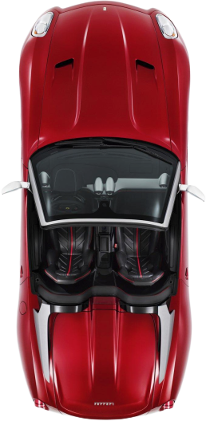

# GA_Racing — NeedForJS

A top-down arcade racing game written in vanilla JavaScript (no frameworks,
no canvas) and packaged as an Electron desktop app. Dodge traffic, rack up
your score, and don't crash!



## How to run

Requires [Node.js](https://nodejs.org/).

```bash
npm install
npm start
```

## Controls

| Key | Action |
| --- | --- |
| ↑ / ↓ | Move up / down the road |
| ← / → | Steer left / right |

Click the start overlay to begin. The game ends when you collide with an
enemy car — click again to restart.

## How it works

| File | Role |
| --- | --- |
| `main.js` | Electron main process — creates the game window |
| `index.html` | Game page markup |
| `script.js` | All game logic: game loop, keyboard input, road and enemy movement, collision detection |
| `style.css` | Game styling |
| `image/` | Car sprites |

Enemy cars spawn at random positions with a random sprite and scroll toward
you; your score grows with distance travelled.

## License

ISC
